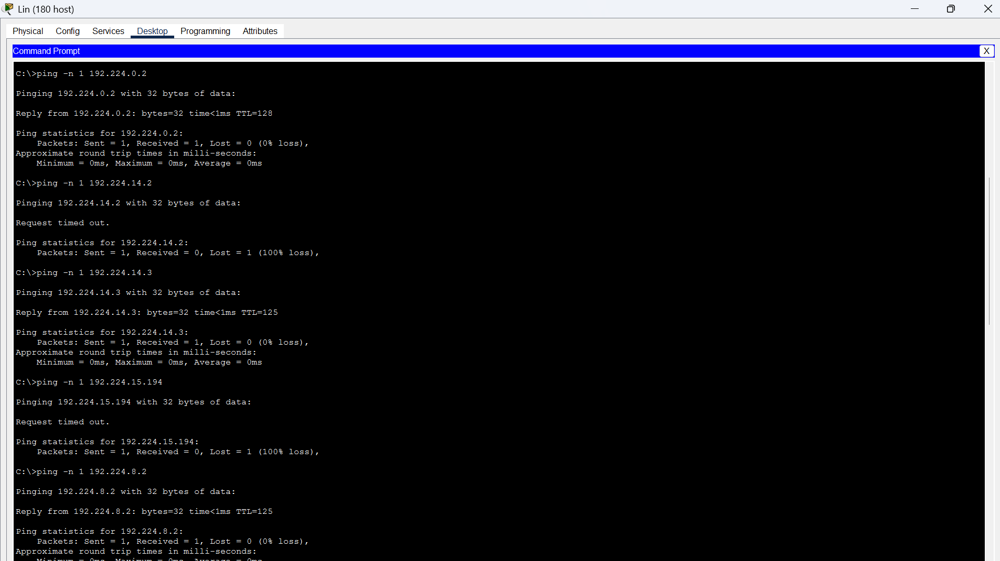
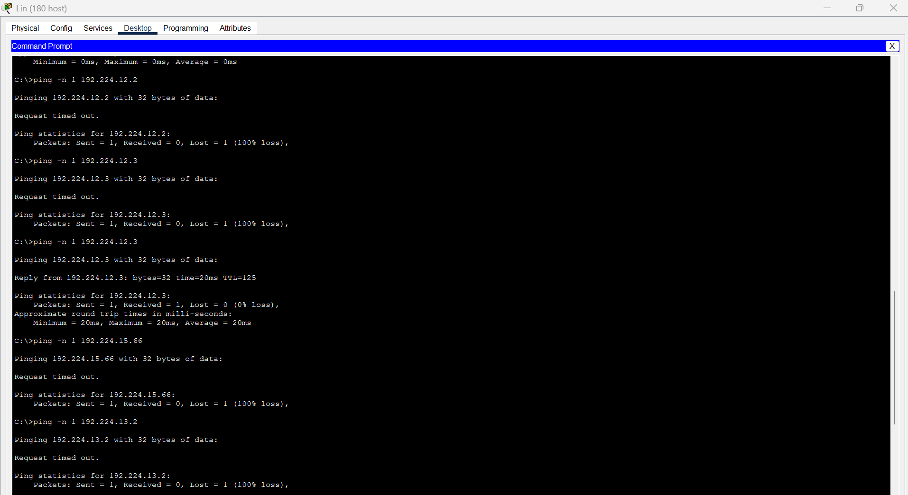
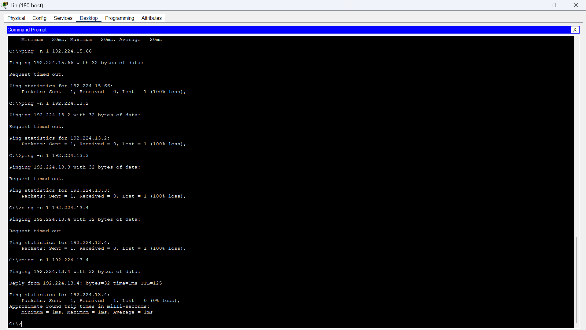
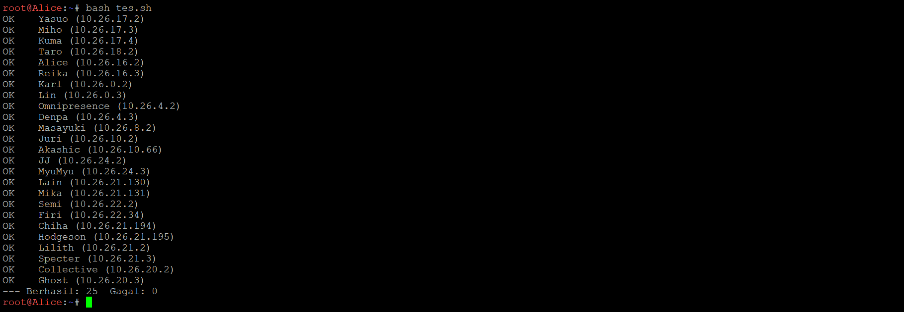

# PRAKTIKUM JARKOM MODUL 4 K 26 - 2026

## Angota Kelompok

| Nama                         | NRP        |
| ---------------------------- | ---------- |
| Az Zahra Fiddien Al Farabi          | 5027251021 |
| Muhammad Faturrahman | 5027241065 |

## Laporan
### link spreadsheet vslm
https://docs.google.com/spreadsheets/d/1uNgu6YnoJJJtBOYZoqTcjRcBaziEp0L-o8dlF3cS3Ro/edit?gid=0#gid=0
### link spreadsheet cidr
https://docs.google.com/spreadsheets/d/1rLz4zUVn2UNdoxPdMNhNxYrD9JLPGYOn/edit?usp=sharing&ouid=111904551256007738552&rtpof=true&sd=true

## CPT-VSLM

1. Berikut topologi yang dibuat untuk cisco packet tracer.

   

   Setelah dilakukan analisa terhadap topologi tersebut, dapat disimpulkan terdapat sebanyak **23 subnet** yang perlu dilakukan.

2. Total penggunaan subnet.

   Total subnet yang digunakan adalah **25 subnet**, terdiri dari 16 subnet LAN dan 9 subnet link antar router (/30). Rinciannya:

   | Prefix | Jumlah subnet | Total alamat |
   |---|---|---|
   | /22 | 2 | 2048 |
   | /23 | 2 | 1024 |
   | /24 | 2 | 512 |
   | /25 | 2 | 256 |
   | /26 | 4 | 256 |
   | /27 | 1 | 32 |
   | /29 | 3 | 24 |
   | /30 | 9 | 36 |
   | **Total** | **25** | **4188** |

   Total kebutuhan host (termasuk 1 IP gateway tiap LAN dan 2 IP tiap link /30) adalah **2814 IP**, sedangkan total IP host yang tersedia di seluruh subnet adalah **4138 IP**.

   Karena total alamat yang dialokasikan (4188) melebihi ukuran blok /20 (4096), blok terkecil yang bisa menampung seluruh subnet adalah **192.224.0.0/19** (8192 alamat). Alamat terakhir yang terpakai adalah 192.224.16.91, sehingga pemakaian blok /19 sekitar 51,1%.

   Berikut adalah hasil VLSM Tree yang ada:

   

3. Static routing.

   Pada praktikum ini hanya diharuskan melakukan static routing. Setiap router dikonfigurasi agar mengetahui jalur ke subnet yang tidak terhubung langsung dengannya. Caranya adalah menelusuri jalur dari satu subnet ke subnet lain, lalu menuliskan network tujuan beserta next hop-nya.

   Prinsip yang digunakan:
   - Router di ujung topologi (Psyche, Copland, Navi, Accela, Shibuya) cukup memakai **default route** ke router di atasnya.
   - Router di tengah memakai default route ke atas, ditambah route spesifik ke subnet yang ada di arah bawah.
   - Cyberia memakai satu **route summary** 192.224.0.0/19 ke Wired.
   - Subnet yang berdekatan digabung (summarization), misalnya 192.224.12.0/23 untuk A11 dan A13, serta 192.224.16.72/29 untuk A16 dan A18.

   | Router | Network tujuan | Next hop |
   |---|---|---|
   | Cyberia | 192.224.0.0/19 | 192.224.16.58 |
   | Wired | 0.0.0.0/0 | 192.224.16.57 |
   | Wired | 192.224.0.0/22 | 192.224.16.34 |
   | Wired | 192.224.8.0/23, 192.224.15.192/26 | 192.224.16.35 |
   | Wired | 192.224.4.0/22, 192.224.16.40/29, 192.224.16.60/30 | 192.224.16.36 |
   | Wired | 192.224.12.0/23, 192.224.15.64/26 | 192.224.16.66 |
   | Wired | 192.224.10.0/23, 192.224.14.128/25, 192.224.15.0/26, 192.224.15.128/26, 192.224.16.0/27, 192.224.16.48/29, 192.224.16.72/29, 192.224.16.80/28 | 192.224.16.70 |
   | Psyche | 0.0.0.0/0 | 192.224.16.33 |
   | Copland | 0.0.0.0/0 | 192.224.16.33 |
   | Schumann | 0.0.0.0/0 | 192.224.16.33 |
   | Schumann | 192.224.4.0/22 | 192.224.16.62 |
   | Accela | 0.0.0.0/0 | 192.224.16.61 |
   | Navi | 0.0.0.0/0 | 192.224.16.65 |
   | Tachibana | 0.0.0.0/0 | 192.224.16.69 |
   | Tachibana | 192.224.14.128/25, 192.224.15.0/26, 192.224.15.128/26, 192.224.16.0/27, 192.224.16.48/29, 192.224.16.76/30, 192.224.16.80/28 | 192.224.16.74 |
   | Deus | 0.0.0.0/0 | 192.224.16.73 |
   | Deus | 192.224.15.0/26, 192.224.15.128/26, 192.224.16.0/27, 192.224.16.48/29, 192.224.16.80/28 | 192.224.16.78 |
   | Protocol7 | 0.0.0.0/0 | 192.224.16.77 |
   | Protocol7 | 192.224.15.0/26, 192.224.16.0/27, 192.224.16.48/29, 192.224.16.84/30, 192.224.16.88/30 | 192.224.16.82 |
   | Knights | 0.0.0.0/0 | 192.224.16.81 |
   | Knights | 192.224.15.0/26, 192.224.16.0/27, 192.224.16.88/30 | 192.224.16.86 |
   | Phantoma | 0.0.0.0/0 | 192.224.16.85 |
   | Phantoma | 192.224.15.0/26 | 192.224.16.90 |
   | Shibuya | 0.0.0.0/0 | 192.224.16.89 |

4. Setting static ip

   IP static diset pada setiap interface router dan setiap client (Desktop > IP Configuration > Static), mengikuti range IP pada Spreadsheet. Aturan yang dipakai: IP pertama yang valid di setiap subnet menjadi gateway (interface router), lalu client mengambil IP berikutnya.

   **a. IP interface router**

   | Router | Interface | IP Address | Prefix | Subnet |
   |---|---|---|---|---|
   | Cyberia | Fa0/1 | 192.224.14.1 | /25 | A1 |
   | Cyberia | Fa1/0 | 192.224.16.57 | /30 | A2 |
   | Wired | Fa0/0 | 192.224.16.58 | /30 | A2 |
   | Wired | Fa0/1 | 192.224.16.33 | /29 | A3 |
   | Wired | Fa1/0 | 192.224.16.65 | /30 | A10 |
   | Wired | Fa1/1 | 192.224.16.69 | /30 | A14 |
   | Psyche | Fa0/0 | 192.224.16.34 | /29 | A3 |
   | Psyche | Fa0/1 | 192.224.0.1 | /22 | A4 |
   | Copland | Fa0/0 | 192.224.16.35 | /29 | A3 |
   | Copland | Fa0/1 | 192.224.15.193 | /26 | A5 |
   | Copland | Fa1/0 | 192.224.8.1 | /23 | A6 |
   | Schumann | Fa0/0 | 192.224.16.36 | /29 | A3 |
   | Schumann | Fa0/1 | 192.224.16.41 | /29 | A7 |
   | Schumann | Fa1/0 | 192.224.16.61 | /30 | A8 |
   | Accela | Fa0/0 | 192.224.16.62 | /30 | A8 |
   | Accela | Fa0/1 | 192.224.4.1 | /22 | A9 |
   | Navi | Fa0/0 | 192.224.16.66 | /30 | A10 |
   | Navi | Fa0/1 | 192.224.12.1 | /24 | A11 |
   | Navi | Fa1/0 | 192.224.15.65 | /26 | A12 |
   | Navi | Fa1/1 | 192.224.13.1 | /24 | A13 |
   | Tachibana | Fa0/0 | 192.224.16.70 | /30 | A14 |
   | Tachibana | Fa0/1 | 192.224.10.1 | /23 | A15 |
   | Tachibana | Fa1/0 | 192.224.16.73 | /30 | A16 |
   | Deus | Fa0/0 | 192.224.16.74 | /30 | A16 |
   | Deus | Fa0/1 | 192.224.14.129 | /25 | A17 |
   | Deus | Fa1/0 | 192.224.16.77 | /30 | A18 |
   | Protocol7 | Fa0/0 | 192.224.16.78 | /30 | A18 |
   | Protocol7 | Fa0/1 | 192.224.15.129 | /26 | A19 |
   | Protocol7 | Fa1/0 | 192.224.16.81 | /30 | A20 |
   | Knights | Fa0/0 | 192.224.16.82 | /30 | A20 |
   | Knights | Fa0/1 | 192.224.16.49 | /29 | A21 |
   | Knights | Fa1/0 | 192.224.16.85 | /30 | A22 |
   | Phantoma | Fa0/0 | 192.224.16.86 | /30 | A22 |
   | Phantoma | Fa0/1 | 192.224.16.1 | /27 | A23 |
   | Phantoma | Fa1/0 | 192.224.16.89 | /30 | A24 |
   | Shibuya | Fa0/0 | 192.224.16.90 | /30 | A24 |
   | Shibuya | Fa0/1 | 192.224.15.1 | /26 | A25 |

   **b. IP client (laptop, PC, server)**

   | Client | Jenis | IP Address | Subnet Mask | Gateway | Subnet |
   |---|---|---|---|---|---|
   | Karl | Server | 192.224.0.2 | 255.255.252.0 | 192.224.0.1 | A4 |
   | Lin | Server | 192.224.0.3 | 255.255.252.0 | 192.224.0.1 | A4 |
   | JJ | PC | 192.224.14.2 | 255.255.255.128 | 192.224.14.1 | A1 |
   | MyuMyu | Laptop | 192.224.14.3 | 255.255.255.128 | 192.224.14.1 | A1 |
   | Juri | Laptop | 192.224.15.194 | 255.255.255.192 | 192.224.15.193 | A5 |
   | Masayuki | Laptop | 192.224.8.2 | 255.255.254.0 | 192.224.8.1 | A6 |
   | Akashic | Server | 192.224.16.42 | 255.255.255.248 | 192.224.16.41 | A7 |
   | Omnipresence | PC | 192.224.4.2 | 255.255.252.0 | 192.224.4.1 | A9 |
   | Denpa | Laptop | 192.224.4.3 | 255.255.252.0 | 192.224.4.1 | A9 |
   | Alice | Laptop | 192.224.12.2 | 255.255.255.0 | 192.224.12.1 | A11 |
   | Reika | PC | 192.224.12.3 | 255.255.255.0 | 192.224.12.1 | A11 |
   | Taro | PC | 192.224.15.66 | 255.255.255.192 | 192.224.15.65 | A12 |
   | Yasuo | PC | 192.224.13.2 | 255.255.255.0 | 192.224.13.1 | A13 |
   | Miho | Laptop | 192.224.13.3 | 255.255.255.0 | 192.224.13.1 | A13 |
   | Kuma | Server | 192.224.13.4 | 255.255.255.0 | 192.224.13.1 | A13 |
   | Collective | Server | 192.224.10.2 | 255.255.254.0 | 192.224.10.1 | A15 |
   | Ghost | PC | 192.224.10.3 | 255.255.254.0 | 192.224.10.1 | A15 |
   | Lilith | Laptop | 192.224.14.130 | 255.255.255.128 | 192.224.14.129 | A17 |
   | Specter | PC | 192.224.14.131 | 255.255.255.128 | 192.224.14.129 | A17 |
   | Chisa | Laptop | 192.224.15.130 | 255.255.255.192 | 192.224.15.129 | A19 |
   | Hodgeson | PC | 192.224.15.131 | 255.255.255.192 | 192.224.15.129 | A19 |
   | Eiri | Server | 192.224.16.50 | 255.255.255.248 | 192.224.16.49 | A21 |
   | Semi | PC | 192.224.16.2 | 255.255.255.224 | 192.224.16.1 | A23 |
   | Lain | Laptop | 192.224.15.2 | 255.255.255.192 | 192.224.15.1 | A25 |
   | Mika | PC | 192.224.15.3 | 255.255.255.192 | 192.224.15.1 | A25 |

### uji ping salah satu klien ke semua klien(Dari lin)

## gns3-CIDR
1. **Topologi GNS3**

   Berikut adalah desain topologi yang dibangun di GNS3. Topologi ini dibagi menjadi 3 wilayah utama (Sayap Kiri, Sayap Kanan, dan Sayap Bawah) yang terhubung ke satu router pusat (**Wired**). Selain itu, router **cyberia** (terhubung ke NAT) berada di atas Wired dengan satu LAN sendiri (A15) dan link ke Wired (A24).

   
   

   | Wilayah | Isi | Router |
   |:-|:-|:-|
   | Sayap Kiri | A7, A8, A9, A10, A11, A22, A25 | Pysche, Copland, Schumann, Accela (lewat Switch2 / A25) |
   | Sayap Kanan | A12, A13, A14, A23 | Navi |
   | Sayap Bawah | A1, A2, A3, A4, A5, A6, A16, A17, A18, A19, A20, A21 | Tachibana, Deus, protocol7, Knights, Phantoma, Shibuya |
   | Cyberia | A15, A24 | cyberia |

2. **Perhitungan Penggabungan IP (Supernetting)**

   Untuk mencapai efisiensi routing, dilakukan penggabungan subnet (*supernetting*) dari subnet-subnet kecil menjadi blok yang lebih besar. Proses ini dilakukan secara bertahap (*bottom-up*) berdasarkan wilayah topologi: hasil gabungan sebelumnya digabung dengan satu subnet berikutnya.

   **Aturan penggabungan:** netmask hasil gabungan adalah blok terkecil yang memuat **total isi** (jumlah ukuran blok semua subnet yang sudah tergabung). Jika total isi masih muat di blok yang ada, netmask tidak berubah (subnet kecil terserap), dan sel tersebut diberi warna abu-abu pada spreadsheet.

  
  Visualisasi pembagian wilayah CIDR dapat dilihat pada gambar berikut:

  

   - **Tahap 1 | Sayap Kiri:**

| Subnet | Gabungan dari (1) | Netmask | Gabungan dari (2) | Netmask | Netmask Akhir | Total Isi (IP) |
|:-:|:-:|:-:|:-:|:-:|:-:|:-:|
| B1 | A8 | /23 | A9 | /26 | /22 | 576 |
| B2 | A22 | /30 | A7 | /22 | /21 | 1028 |
| C1 | B2 | /21 | A11 | /29 | /21 | 1036 |
| D1 | C1 | /21 | B1 | /22 | /21 | 1612 |
| E1 | D1 | /21 | A10 | /22 | /20 | 2636 |
| F1 | E1 | /20 | A25 | /29 | /20 | 2644 |

   - **Tahap 2 | Sayap Kanan:**

| Subnet | Gabungan dari (1) | Netmask | Gabungan dari (2) | Netmask | Netmask Akhir | Total Isi (IP) |
|:-:|:-:|:-:|:-:|:-:|:-:|:-:|
| B4 | A13 | /26 | A14 | /24 | /23 | 320 |
| C2 | B4 | /23 | A12 | /24 | /22 | 576 |
| D2 | C2 | /22 | A23 | /30 | /22 | 580 |

   - **Tahap 3 | Sayap Bawah:**

| Subnet | Gabungan dari (1) | Netmask | Gabungan dari (2) | Netmask | Netmask Akhir | Total Isi (IP) |
|:-:|:-:|:-:|:-:|:-:|:-:|:-:|
| B3 | A1 | /26 | A16 | /30 | /25 | 68 |
| C3 | B3 | /25 | A2 | /27 | /25 | 100 |
| D3 | C3 | /25 | A17 | /30 | /25 | 104 |
| E2 | D3 | /25 | A3 | /29 | /25 | 112 |
| F2 | E2 | /25 | A18 | /30 | /25 | 116 |
| G1 | F2 | /25 | A4 | /26 | /24 | 180 |
| H1 | G1 | /24 | A19 | /30 | /24 | 184 |
| I1 | H1 | /24 | A5 | /25 | /23 | 312 |
| J1 | I1 | /23 | A20 | /30 | /23 | 316 |
| K1 | J1 | /23 | A6 | /24 | /22 | 572 |
| K2 | K1 | /22 | A21 | /30 | /22 | 576 |

   - **Tahap 4 | Gabungan seluruh sayap** (tiap sayap dihitung sebesar blok netmask akhirnya):

| Subnet | Gabungan dari (1) | Netmask | Gabungan dari (2) | Netmask | Netmask Akhir | Total Isi (IP) |
|:-:|:-:|:-:|:-:|:-:|:-:|:-:|
| L1 | K2 | /22 | D2 | /22 | /21 | 2048 |
| L2 | L1 | /21 | F1 | /20 | /19 | 6144 |
| L3 | L2 | /19 | A24 | /30 | /19 | 6148 |
| L4 | L3 | /19 | A15 | /25 | /19 | 6276 |

   - **Hasil Akhir Penggabungan (Supernet Utama):**
     Berdasarkan ukuran blok seluruh subnet pada tiap wilayah, didapatkan 3 Blok Supernet Utama yang didaftarkan pada router pusat (Wired), ditambah A15 dan A24 di sisi cyberia:

     * **Sayap Kiri (1738 IP dibutuhkan, total blok 2644):** Membutuhkan blok **/20**. Dialokasikan `10.26.0.0/20`.
     * **Sayap Kanan (457 IP dibutuhkan, total blok 580):** Membutuhkan blok **/22**. Dialokasikan `10.26.16.0/22`.
     * **Sayap Bawah (416 IP dibutuhkan, total blok 576):** Membutuhkan blok **/22**. Dialokasikan `10.26.20.0/22`.
     * **Cyberia (A15 dan A24):** A15 `10.26.24.0/25` dan A24 `10.26.24.128/30`.
     * **Seluruh topologi:** teragregasi menjadi **`10.26.0.0/19`**. Pada router cyberia cukup satu route `10.26.0.0/19` menuju Wired.

     > Catatan: ukuran blok ditentukan oleh jumlah **ukuran blok subnet** (setiap subnet menempati blok berpangkat 2), bukan jumlah host. Contohnya Sayap Kiri hanya butuh 1738 IP, tetapi total blok subnetnya 2644, sehingga harus /20 (bukan /21).

3. **Perhitungan Pembagian IP (Subnetting)**

   Setelah blok induk dibagi ke masing-masing sayap, dilakukan pembagian IP ke setiap subnet (A1 - A25). Di dalam tiap sayap, subnet diurutkan dari CIDR terbesar, lalu kebutuhan terbesar, agar setiap blok sejajar dengan batas alamatnya. Subnet `/30` adalah link WAN antar router, dan *Buddy Pair* adalah dua subnet sama besar yang bersebelahan.

   | Sayap | Subnet | Kebutuhan Host | CIDR | Network ID | Broadcast | Range IP Usable | Catatan |
   |:-|:-:|:-:|:-:|:-:|:-:|:-:|:-:|
   | **KIRI** | **A10** | 881 | **/22** | **10.26.0.0** | 10.26.3.255 | 10.26.0.1 - 10.26.3.254 | Buddy Pair |
   | (Blok: 10.26.0.0/20) | **A7** | 514 | **/22** | **10.26.4.0** | 10.26.7.255 | 10.26.4.1 - 10.26.7.254 | dg A10 |
   |  | **A8** | 301 | **/23** | **10.26.8.0** | 10.26.9.255 | 10.26.8.1 - 10.26.9.254 |  |
   |  | **A9** | 32 | **/26** | **10.26.10.0** | 10.26.10.63 | 10.26.10.1 - 10.26.10.62 |  |
   |  | **A11** | 4 | **/29** | **10.26.10.64** | 10.26.10.71 | 10.26.10.65 - 10.26.10.70 | Buddy Pair |
   |  | **A25** | 4 | **/29** | **10.26.10.72** | 10.26.10.79 | 10.26.10.73 - 10.26.10.78 | dg A11 |
   |  | **A22** | 2 | **/30** | **10.26.10.80** | 10.26.10.83 | 10.26.10.81 - 10.26.10.82 | WAN |
   | **KANAN** | **A14** | 254 | **/24** | **10.26.16.0** | 10.26.16.255 | 10.26.16.1 - 10.26.16.254 | Buddy Pair |
   | (Blok: 10.26.16.0/22) | **A12** | 143 | **/24** | **10.26.17.0** | 10.26.17.255 | 10.26.17.1 - 10.26.17.254 | dg A14 |
   |  | **A13** | 58 | **/26** | **10.26.18.0** | 10.26.18.63 | 10.26.18.1 - 10.26.18.62 |  |
   |  | **A23** | 2 | **/30** | **10.26.18.64** | 10.26.18.67 | 10.26.18.65 - 10.26.18.66 | WAN |
   | **BAWAH** | **A6** | 207 | **/24** | **10.26.20.0** | 10.26.20.255 | 10.26.20.1 - 10.26.20.254 |  |
   | (Blok: 10.26.20.0/22) | **A5** | 84 | **/25** | **10.26.21.0** | 10.26.21.127 | 10.26.21.1 - 10.26.21.126 |  |
   |  | **A1** | 62 | **/26** | **10.26.21.128** | 10.26.21.191 | 10.26.21.129 - 10.26.21.190 | Buddy Pair |
   |  | **A4** | 33 | **/26** | **10.26.21.192** | 10.26.21.255 | 10.26.21.193 - 10.26.21.254 | dg A1 |
   |  | **A2** | 15 | **/27** | **10.26.22.0** | 10.26.22.31 | 10.26.22.1 - 10.26.22.30 |  |
   |  | **A3** | 3 | **/29** | **10.26.22.32** | 10.26.22.39 | 10.26.22.33 - 10.26.22.38 |  |
   |  | **A16** | 2 | **/30** | **10.26.22.40** | 10.26.22.43 | 10.26.22.41 - 10.26.22.42 | WAN |
   |  | **A17** | 2 | **/30** | **10.26.22.44** | 10.26.22.47 | 10.26.22.45 - 10.26.22.46 | WAN |
   |  | **A18** | 2 | **/30** | **10.26.22.48** | 10.26.22.51 | 10.26.22.49 - 10.26.22.50 | WAN |
   |  | **A19** | 2 | **/30** | **10.26.22.52** | 10.26.22.55 | 10.26.22.53 - 10.26.22.54 | WAN |
   |  | **A20** | 2 | **/30** | **10.26.22.56** | 10.26.22.59 | 10.26.22.57 - 10.26.22.58 | WAN |
   |  | **A21** | 2 | **/30** | **10.26.22.60** | 10.26.22.63 | 10.26.22.61 - 10.26.22.62 | WAN |
   | **CYBERIA** | **A15** | 126 | **/25** | **10.26.24.0** | 10.26.24.127 | 10.26.24.1 - 10.26.24.126 |  |
   | (Blok: 10.26.24.0/25 & 10.26.24.128/30) | **A24** | 2 | **/30** | **10.26.24.128** | 10.26.24.131 | 10.26.24.129 - 10.26.24.130 | WAN |

   #### **Studi Kasus Perhitungan: Subnet A10**
   Berikut adalah contoh detail langkah-langkah mendapatkan Prefix, Network ID, Broadcast, dan Range IP untuk **Subnet A10** (Sayap Kiri):

   **a. Menentukan Prefix (CIDR)**
   * **Kebutuhan Host:** 881 Host (700 + 180 host, ditambah 1 interface router Pysche).
   * **Rumus:** $2^n - 2 \geq \text{Kebutuhan Host}$.
   * **Pencarian $n$ (Bit Host):**
       * $2^9 = 512$ (Kurang)
       * $2^{10} = 1024$ (Cukup) $\rightarrow$ Maka, $n = 10$.
   * **Prefix CIDR:** $32 - n = 32 - 10 = \mathbf{/22}$.

   **b. Menghitung Block Size (Total IP)**
   * Rumus: $2^{(32 - \text{Prefix})} = 2^{(32-22)} = 2^{10} = \mathbf{1024}$ IP.
   * Karena 1 oktet bernilai 256, maka $1024 / 256 = 4$. Ini berarti subnet ini akan memakan **4 angka** pada oktet ketiga IP.

   **c. Menentukan Network ID (NID) & Broadcast**
   * **Network ID (Awal):**
       Karena A10 adalah subnet pertama di Sayap Kiri (Block 10.26.0.0/20), maka NID dimulai dari **`10.26.0.0`**.
   * **Next Network (Batas Atas):**
       NID Awal + Block Size (di oktet ke-3) $\rightarrow$ $0 + 4 = 4$.
       Jadi subnet berikutnya dimulai di `10.26.4.0`.
   * **Broadcast Address (Akhir):**
       Satu angka sebelum *Next Network* (`10.26.4.0`).
       Maka Broadcastnya adalah **`10.26.3.255`**.

   **d. Menentukan Range IP Usable**
   * **IP Pertama:** Network ID + 1 $\rightarrow$ **`10.26.0.1`**.
   * **IP Terakhir:** Broadcast - 1 $\rightarrow$ **`10.26.3.254`**.

   **e. Efisiensi Penggunaan CIDR Secara Keseluruhan**
   * Seluruh topologi membutuhkan **2.739 host**: Sayap Kiri 1.738 host, Sayap Kanan 457 host, Sayap Bawah 416 host, serta Cyberia 128 host.
   * Prefix induk `10.26.0.0/19` menyediakan $2^{13} = 8192$ alamat, atau **8190 alamat usable** setelah dikurangi network ID dan broadcast.
   * Efisiensi penggunaan berdasarkan host adalah $2739/8190 \times 100\% \approx \mathbf{33,4\%}$, sehingga masih tersedia **5.451 alamat usable** untuk pengembangan.
   * Jika dihitung berdasarkan blok alamat yang dialokasikan oleh seluruh subnet, totalnya **6.276 alamat** dari 8.192 alamat, atau sekitar **76,6%**. Perbedaan ini terjadi karena setiap subnet harus menggunakan ukuran blok berpangkat dua, sehingga sebagian alamat dialokasikan tetapi belum digunakan oleh host.

### Uji ping dari Alice ke semua client

Pengujian konektivitas dilakukan dari client **Alice** dengan menjalankan script [`tes.sh`](./script/tes.sh). Script tersebut menguji koneksi ke seluruh client pada topologi GNS3. Hasil pengujian menunjukkan **25 koneksi berhasil** dan **0 koneksi gagal**.

